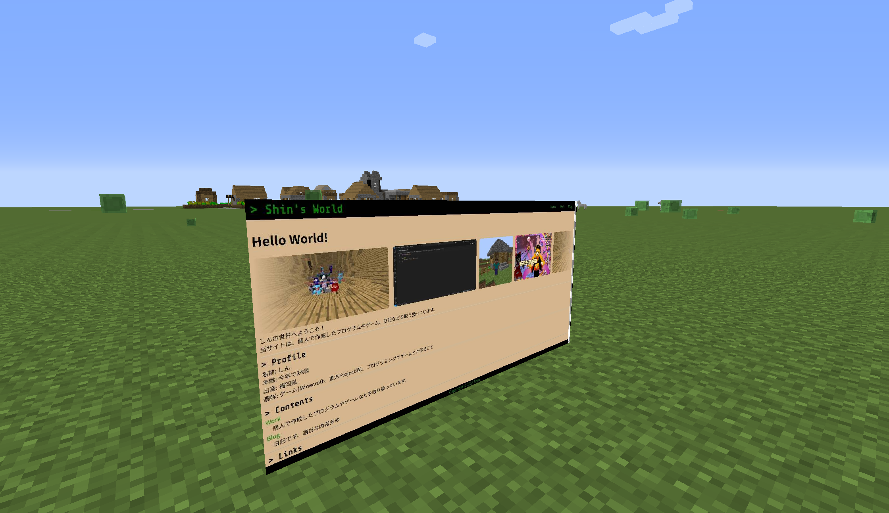

# ScreenCapture (ScreenCaptureMod)

ブラウザの画面共有 (Screen Capture API) を利用して、PC 画面や特定ウィンドウを Minecraft 1.7.10 のゲーム内にリアルタイムで投影・表示する Forge Mod です。



---

> [!WARNING]
> ### ⚠️ 重要：マルチプレイでの表示について
> **本 Mod は完全なクライアントサイド Mod です。**  
> **画面共有は Mod を導入したプレイヤー自身の画面（視点）でのみ描画・表示され、マルチプレイサーバー上の他プレイヤーに画面が共有・同期されるわけではありません（他のプレイヤーからは一切見えません）。**

> [!NOTE]
> ### 💡 このプロジェクトについて (Vibe Coding)
> 本プロジェクトの大部分は、バイブコーディングで開発しました。  
> こういうこともできるんだなー程度に見てください。不具合あったらごめんなさい :(

---

## 🌟 主な特徴

- **ブラウザ経由のリアルタイム画面共有**:
  - Web ブラウザ標準の Screen Capture API を利用し、特別な外部キャプチャソフトなしで画面共有が可能。
  - ディスプレイ全体、特定アプリケーションウィンドウ、ブラウザタブのいずれも投影可能。
- **ゲーム内ワールド空間へのモニター配置**:
  - ゲーム内の任意の位置・方角にスクリーン（モニター）を設置可能。
  - スクリーンのサイズや反転表示（Flip）のカスタマイズに対応。
- **HUD オーバーレイ表示**:
  - 画面上の HUD として手軽に画面共有オーバーレイを表示可能。
- **コマンドによる直感的な操作**:
  - タブ補完付きの `/screencapture` コマンドで簡単に操作・設定が可能。

---

## 🔧 動作要件

| 項目 | 要件 |
| :--- | :--- |
| **Minecraft** | 1.7.10 |
| **Minecraft Forge** | 10.13.4.1614 推奨 |
| **動作ブラウザ** | Chromium 系ブラウザ (Chrome, Edge など) / Firefox |

---

## 🚀 使い方

### 1. キャプチャの開始
ゲーム内で以下のコマンドを実行します:
```text
/screencapture start
```
コマンドを実行するとローカル HTTP サーバーが起動し、ブラウザでキャプチャ用 Web ページ（`http://localhost:8765/`）が自動で開きます。  
ブラウザ上で「画面を共有」をクリックし、共有したい画面またはウィンドウを選択してください。

### 2. キャプチャの停止
```text
/screencapture stop
```

---

## 💻 コマンド一覧

| コマンド | 説明 |
| :--- | :--- |
| `/screencapture start` | キャプチャセッションを開始し、ブラウザを開きます |
| `/screencapture stop` | キャプチャセッションを停止します |
| `/screencapture show` | 画面上のオーバーレイ表示を切り替えます |
| `/screencapture clear` | 画面上のオーバーレイを非表示にします |
| `/screencapture set location` | 現在のプレイヤー位置を基準にワールド内モニターを設置します |
| `/screencapture set size <width> <height>` | モニターのサイズを設定します |
| `/screencapture set flip <true\|false>` | モニターの反転表示を設定します |
| `/screencapture remove` | 設置したワールド内モニターを削除します |
| `/screencapture status` | 現在のキャプチャ状態を確認します |
| `/screencapture help` | コマンドのヘルプを表示します |

---

## 📄 ライセンス

本プロジェクトは [MIT License](LICENSE) の下で公開されています。
