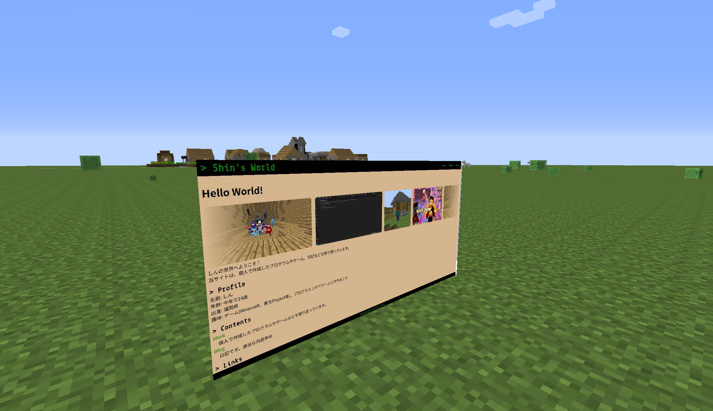

# ScreenCaptureControl (ScreenCaptureControlMod - C++ JNI Edition)

Windows のデスクトップ全体や特定アプリケーションウィンドウを、Minecraft 1.7.10 のゲーム内空間に**超低遅延**で投影し、ゲームの中から**直接マウス・キーボードで操作（Interactive Control）**できる Forge Mod です。



---

> [!WARNING]
> ### ⚠️ 重要：マルチプレイでの表示について
> **本 Mod は完全なクライアントサイド Mod です。**  
> **画面投影および操作は Mod を導入したプレイヤー自身の画面（視点・環境）でのみ実行され、マルチプレイサーバー上の他プレイヤーに画面が共有・同期されたり、他プレイヤーの PC が操作されるわけではありません。**

> [!NOTE]
> ### 💡 このプロジェクトについて (Vibe Coding)
> 本プロジェクトの大部分は、バイブコーディングで開発しました。  
> こういうこともできるんだなー程度に見てください。不具合があったらごめんなさい :(

---

## 🌟 主な特徴

- **C++20 JNI インプロセス超低遅延エンジン (`ScreenCaptureNative.dll`)**:
  - 外部 `.exe` プロセスや WebSocket 通信、一時ファイルを一切使わず、Mod JAR に内蔵された軽量 C++ ネイティブ DLL（約 95 KB）を JNI 経由で Minecraft プロセス内に直接ロードして実行。
  - **Windows.Graphics.Capture (WGC) & Direct3D 11**: GPU スレッド優先度最大化（`+7`）および 1 フレーム遅延設定により、60fps で滑らかに画面を取得。
  - **インプロセス Direct `ByteBuffer` ゼロコピー転送**: C++ 側の 64-byte アラインメントメモリ（`_aligned_malloc`）へ **AVX2 SIMD（`_mm256_stream_load_si256` / `vmovntdqa`）** で直接書き込み、Java 側の `GL11.glTexSubImage2D` が同一メモリ空間からゼロコピーで GPU テクスチャへアップロードします。
- **ゲーム内からのリアルタイム双方向操作 (Interactive Control)**:
  - キャプチャ画面を直接マウスクリック、ドラッグ、ホイールスクロール、キーボード入力可能！
  - **0ms ローカルカーソル描画**: 手元のマウスの動きに対して 1 ミリ秒も遅れずにカーソルが追従します。
  - **1000Hz 物理キーボード直接検知**: Minecraft（LWJGL）の描画ループ周期を介さず、C++ 専用スレッドが Windows カーネルから直接 1000Hz（`GetAsyncKeyState`）で物理キー入力をポーリング注入。
  - **高精度なキー入力同期**: `AttachThreadInput` と `SetKeyboardState` により、Windows ネイティブアプリケーションに対しても瞬間的なキー入力や長押し操作を 1 フレームの取りこぼしもなく正確に伝達。
  - **Windows 10/11 バックグラウンド制限の自動解除**: キャプチャ対象プロセスの EcoQoS / タイマー解像度制限（15.6ms 間引き）を自動解除し、Minecraft を操作中も裏で 60fps 安定動作させます。
- **ゲーム内ワールド空間への 3D モニター配置 & HUD オーバーレイ**:
  - ゲーム内の任意の位置・方角・サイズで 3D スクリーン（モニター）を設置可能。
  - 画面右上の HUD（ワイプ）としても表示可能。
  - ※ **マウス操作に対応しているのは画面右上の「HUD オーバーレイ画面」のみです**（ワールド内に設置した 3D モニターへの直接マウス操作には対応していません。詳細は後述の注意点を参照）。

---

## 🔧 動作要件

| 項目 | 要件 |
| :--- | :--- |
| **OS** | Windows 10 (バージョン 1903 以降, 64-bit) / Windows 11 |
| **Minecraft** | 1.7.10 (64-bit Java 8) |
| **Minecraft Forge** | 10.13.4.1614 推奨 |
| **外部ツール / ランタイム** | **不要（Mod JAR 単体で完結）** |

---

## 📦 導入方法 (インストール)

1. 本 Mod の JAR ファイル（`screencapturecontrolmod-*.jar`）を `.minecraft/mods` フォルダに配置するだけで完了です。
   - ネイティブ DLL（`ScreenCaptureNative.dll`）は Mod JAR 内に同梱されており、実行時に `mods` と同じ階層の `.minecraft/screencapturecontrol/ScreenCaptureNative.dll` へ自動展開・ハッシュ検証されてロードされます。

---

## 🚀 使い方

### 1. キャプチャの開始・ウィンドウの選択
ゲーム内で以下のコマンドを実行します:
```text
/screencapturecontrol start
```
コマンドを実行すると即座にキャプチャが開始され、チャット欄に**キャプチャ可能なウィンドウ一覧**が表示されます。  
チャット欄（`T` キー）を開いて**投影したいウィンドウ名をマウスでクリック**するか、以下のコマンドでいつでも対象を切り替えられます:
```text
/screencapturecontrol window <番号またはウィンドウ名またはdesktop>
```

### 2. 操作モードの開始・終了
- **開始**: キーボードの **`O` キー**（または `/screencapturecontrol interact`）を押すと、マウス・キーボードの操作モードに入ります。
- **終了**: **`Shift + ESC` キー** を押すと通常のゲーム画面に戻ります（単体の `ESC` キーはキャプチャ先のアプリ・ゲームにそのまま送信されます）。

> [!IMPORTANT]
> ### 🖱️ マウス操作に関する重要な仕様・注意点
> - **マウス操作（カーソル移動・クリック・ドラッグ・ホイールスクロール）は、画面右上に表示される「HUD オーバーレイ画面」でのみ行えます。**
> - `/screencapturecontrol set location` コマンドでワールド空間内に設置した **3D モニターに対する直接のマウス操作（空間上の視線・レイキャスト操作）には現在対応していません。**
> - ワールド内に 3D モニターを設置して投影している場合でも、画面右上の HUD を表示（`/screencapturecontrol show`）させた状態で HUD 上にカーソルを合わせることで、マウス操作を行うことができます。
> - なお、**キーボード入力（文字入力や移動・ショートカットキー）**は、HUD・3D モニターのどちらを表示している場合でも、操作モード（`O` キー）中であれば正常に対象アプリへ送信されます。

### 3. キャプチャの停止
```text
/screencapturecontrol stop
```

---

## 💻 コマンド一覧

| コマンド | 説明 |
| :--- | :--- |
| `/screencapturecontrol start` | C++ JNI ネイティブキャプチャを開始し、ウィンドウ一覧を表示します |
| `/screencapturecontrol stop` | キャプチャセッションを停止します |
| `/screencapturecontrol interact` | インタラクティブ操作モードを開始します（`O` キーでも起動可能） |
| `/screencapturecontrol window` | 現在キャプチャ可能なウィンドウ一覧を表示します（チャットクリックで切替可） |
| `/screencapturecontrol window <番号\|名前\|desktop>` | キャプチャ対象のウィンドウまたはデスクトップを切り替えます |
| `/screencapturecontrol scale <full\|half>` | 解像度スケールを切り替えます（full: 1:1 等倍解像度 / half: 1/2 解像度） |
| `/screencapturecontrol cursor <on\|off>` | キャプチャ映像への OS カーソル焼き込み表示を切り替えます |
| `/screencapturecontrol show` | 画面上の HUD オーバーレイを表示します |
| `/screencapturecontrol clear` | 画面上の HUD オーバーレイを非表示にします |
| `/screencapturecontrol set location here` | 現在のプレイヤーの視線位置（ブロック面）に合わせてワールド内モニターを設置します |
| `/screencapturecontrol set location <x> <y> <z>` | 指定した座標にワールド内モニターを設置します |
| `/screencapturecontrol set size <width>` | モニターの横幅（ブロック数）を設定します（高さはアスペクト比から自動算出） |
| `/screencapturecontrol set flip <north\|south\|east\|west>` | モニターの向き（方角）を設定します |
| `/screencapturecontrol remove` | 設置したワールド内モニターを削除します |
| `/screencapturecontrol status` | 現在のキャプチャ状態・FPS・ターゲット名を確認します |
| `/screencapturecontrol help` | コマンドのヘルプを表示します |

---

## 🛠️ ネイティブ DLL のビルド方法（開発者向け）

Visual Studio 2022 (C++ x64 ツールチェーン) がインストールされている環境で、以下のバッチスクリプトを実行すると `src/main/resources/natives/ScreenCaptureNative.dll` が再ビルドされます:
```bat
native\ScreenCaptureNative\build_native.bat
```

---

## 📄 ライセンス

本プロジェクトは [MIT License](LICENSE) の下で公開されています。
